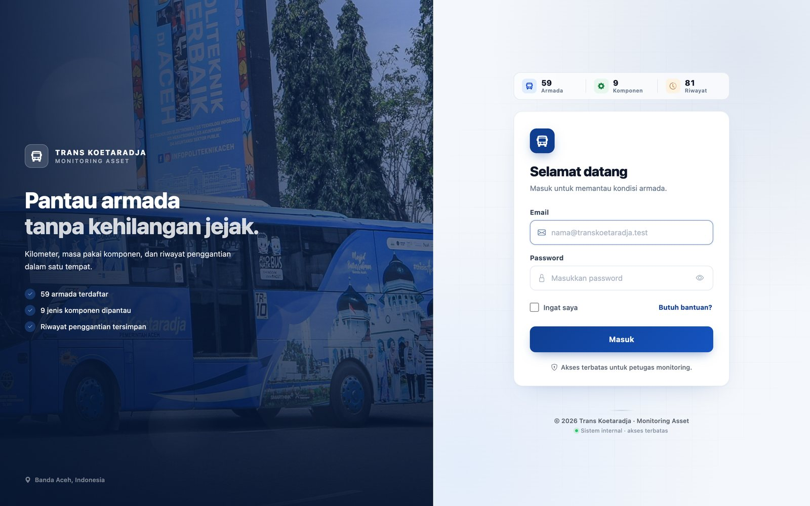
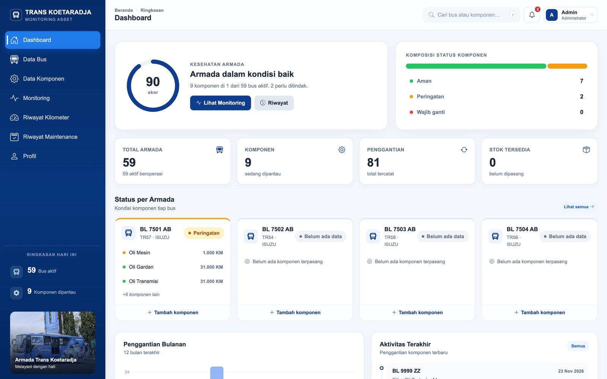
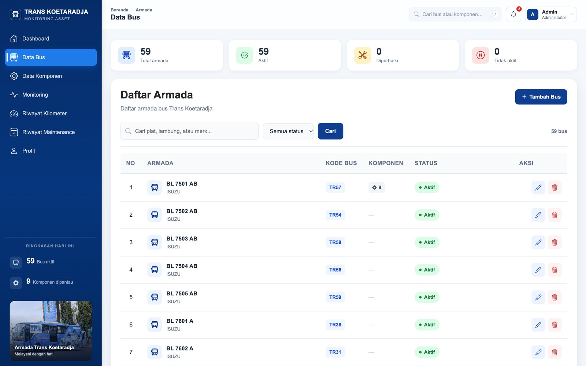
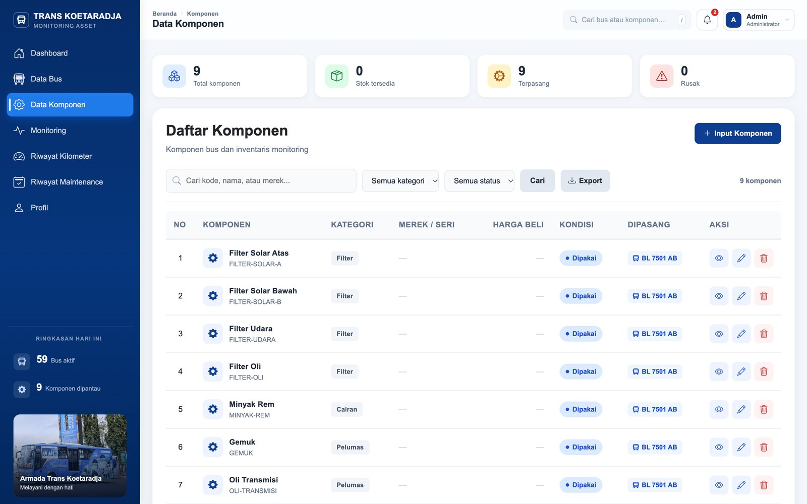
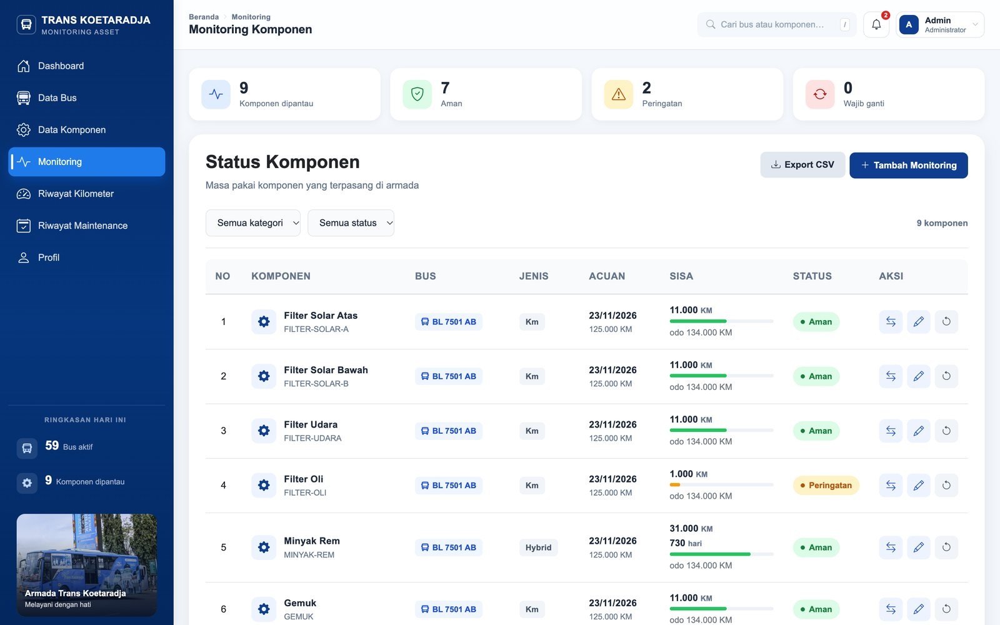
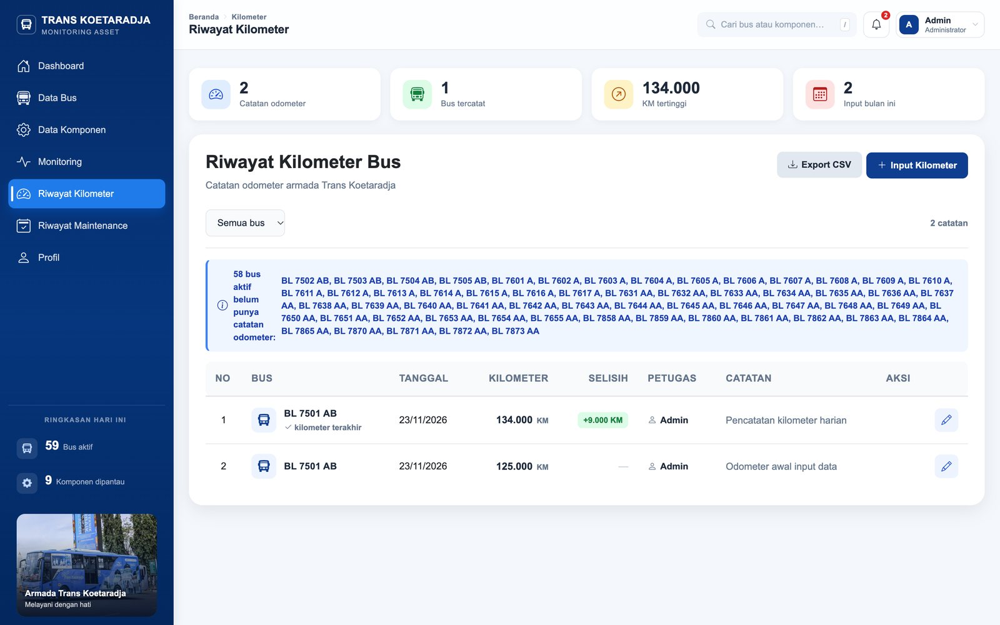
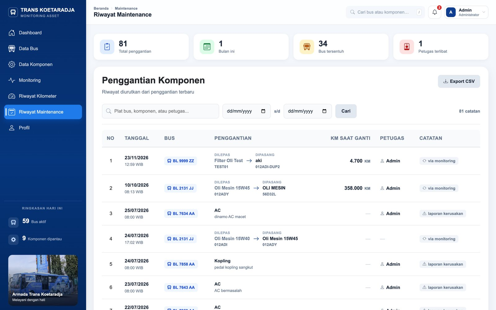
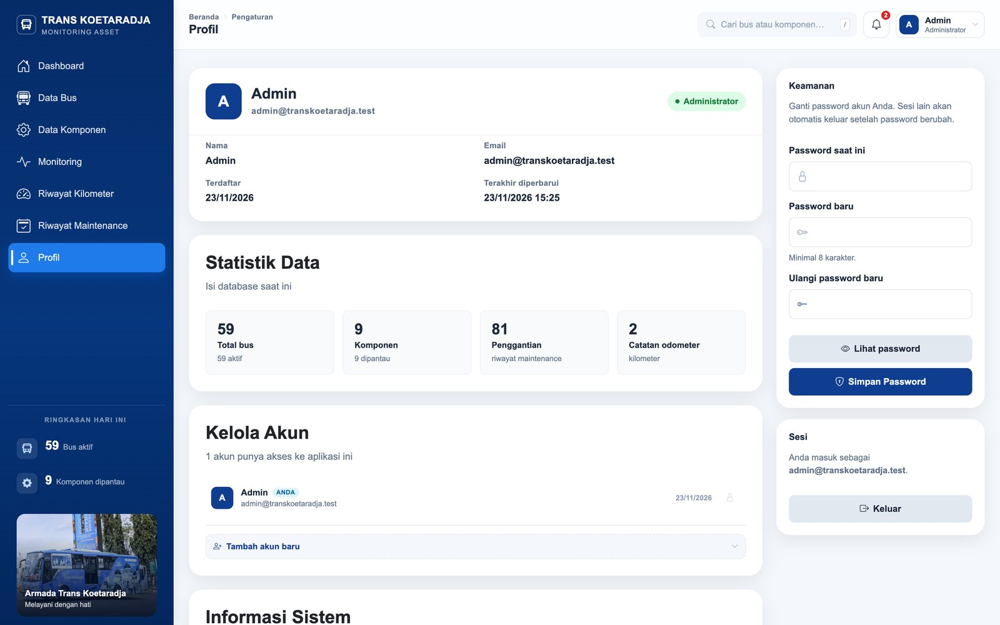
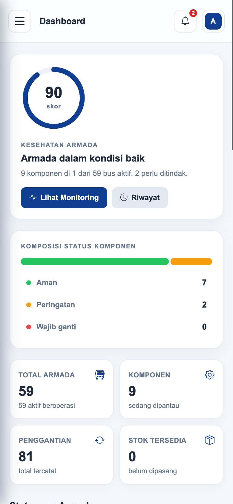

<div align="center">


# Trans Koetaradja — Monitoring Asset

**Sistem pemantauan aset dan perawatan armada bus**

Aplikasi web untuk mencatat kilometer, menghitung masa pakai komponen,
dan menyimpan riwayat penggantian suku cadang armada bus Trans Koetaradja.

[](https://laravel.com)
[](https://php.net)
[](https://mariadb.org)
[](https://docker.com)
[](LICENSE)

</div>

---

## Daftar Isi

- [Latar Belakang](#latar-belakang)
- [Tampilan Aplikasi](#tampilan-aplikasi)
- [Fitur](#fitur)
- [Cara Kerja Status Komponen](#cara-kerja-status-komponen)
- [Teknologi](#teknologi)
- [Menjalankan Aplikasi](#menjalankan-aplikasi)
- [Struktur Proyek](#struktur-proyek)
- [Skema Database](#skema-database)
- [Akun Default](#akun-default)
- [Deploy ke Hosting](#deploy-ke-hosting)
- [Catatan Pengembangan](#catatan-pengembangan)

---

## Latar Belakang

Armada bus beroperasi setiap hari, dan setiap komponen punya masa pakai sendiri.
Oli mesin harus diganti tiap 10.000 KM, filter udara tiap 20.000 KM, minyak rem
tiap 24 bulan. Tanpa pencatatan, penggantian bergantung pada ingatan atau
perkiraan — komponen bisa lewat jadwal, dan kerusakan baru ketahuan setelah bus
mogok di jalan.

Aplikasi ini menyimpan tiga hal yang saling terkait:

1. **Kilometer terakhir** tiap bus
2. **Komponen apa** yang terpasang di bus mana
3. **Kapan dan pada KM berapa** komponen itu terakhir diganti

Dari tiga data itu, sistem menghitung sendiri sisa masa pakai dan memberi status
**Aman**, **Peringatan**, atau **Wajib Ganti** — tanpa perlu hitung manual.

---

## Tampilan Aplikasi

### Halaman Masuk

Split screen: foto armada di kiri, form di kanan, dengan strip ringkasan data.



### Dashboard

Skor kesehatan armada, komposisi status komponen, kartu metrik, status tiap bus,
grafik penggantian bulanan, dan aktivitas terakhir.



### Data Bus

Daftar seluruh armada dengan pencarian, filter status, dan ringkasan.



### Data Komponen

Inventaris suku cadang: mana yang masih di gudang, mana yang terpasang, mana yang
rusak.



### Monitoring Komponen

Inti aplikasi. Menampilkan sisa masa pakai tiap komponen beserta statusnya.



### Riwayat Kilometer

Catatan odometer per bus, lengkap dengan selisih antar pencatatan.



### Riwayat Maintenance

Jejak penggantian komponen: apa yang dilepas, apa yang dipasang, di bus mana,
pada KM berapa.



### Profil & Pengaturan

Informasi sistem, kelola akun pengguna, dan ganti password.



### Tampilan Ponsel

Seluruh halaman responsif; sidebar berubah jadi drawer di layar kecil.



---

## Fitur

### Manajemen Armada

- Tambah, ubah, hapus data bus
- Pencarian berdasarkan plat, kode lambung, atau merek
- Filter berdasarkan status (aktif / service / nonaktif)
- Ringkasan jumlah armada per status

### Inventaris Komponen

- Pencatatan kode alat, nama, kategori, merek, seri, supplier, harga beli
- Status barang: **Tersedia** (di gudang), **Terpasang** (di bus), **Rusak**
- Pemisahan jelas antara *kondisi* dan *lokasi pemasangan*
- Hapus komponen otomatis melepas monitoring yang menempel

### Monitoring Masa Pakai

- Dua jenis perhitungan: **berbasis KM**, **berbasis waktu**, atau **keduanya (hybrid)**
- Ambang peringatan bisa diatur per komponen
- Sisa masa pakai dalam KM atau hari
- Reset pengingat setelah penggantian

### Pencatatan Kilometer

- Input odometer per bus dengan validasi
- Kilometer tidak boleh turun dari catatan terakhir
- Tanggal tidak boleh melewati hari ini
- Kolom **selisih** otomatis antar pencatatan

### Riwayat Maintenance

- Tercatat otomatis saat komponen diganti lewat menu Monitoring
- Menampilkan komponen lama → komponen baru
- Filter berdasarkan kata kunci dan rentang tanggal
- Bisa mencatat laporan kerusakan (bukan hanya penggantian)

### Dashboard

- Skor kesehatan armada (0–100)
- Komposisi status komponen dalam satu bar
- Status per bus: komponen mana yang mendekati habis
- Grafik penggantian 12 bulan terakhir
- Timeline aktivitas terakhir

### Akun & Keamanan

- Login dengan email dan password
- Tambah dan hapus akun pengguna
- Ganti password (sesi lain otomatis keluar)
- Akun yang sedang dipakai tidak bisa dihapus

### Ekspor Data

Tiga endpoint CSV siap unduh:

| Endpoint | Isi |
|---|---|
| `/export/monitoring` | Seluruh data monitoring komponen |
| `/export/maintenance` | Riwayat penggantian |
| `/export/odometer` | Catatan kilometer |

### Antarmuka

- Responsif penuh: desktop, iPad, dan ponsel
- Sidebar berubah jadi drawer di bawah 768px
- Animasi masuk bertahap, dihormati `prefers-reduced-motion`
- Satu stylesheet terpusat — tidak ada CSS tersebar per halaman

---

## Cara Kerja Status Komponen

Setiap komponen punya titik acuan: tanggal pemasangan dan/atau kilometer saat
dipasang. Dari situ sistem menghitung kapan komponen harus diganti.

### Jalur Kilometer

```
target_ganti   = km_acuan + batas_km
sisa_km        = target_ganti − km_terakhir_bus

sisa_km ≤ 0                → Wajib Ganti
sisa_km ≤ warning_km       → Peringatan
selain itu                 → Aman
```

### Jalur Waktu

```
tanggal_ganti  = tanggal_acuan + batas_waktu_bulan
sisa_hari      = tanggal_ganti − hari ini

sisa_hari ≤ 0              → Wajib Ganti
sisa_hari ≤ warning_hari   → Peringatan
selain itu                 → Aman
```

### Hybrid

Komponen bertipe `hybrid` dihitung lewat **kedua jalur**, lalu diambil yang
paling buruk. Minyak rem misalnya: 40.000 KM **atau** 24 bulan, mana yang lebih
dulu tercapai.

### Contoh Nyata

Bus dengan odometer 134.000 KM, oli mesin dipasang pada 125.000 KM dengan batas
10.000 KM dan peringatan 2.000 KM:

```
target = 125.000 + 10.000 = 135.000
sisa   = 135.000 − 134.000 = 1.000 KM
1.000 ≤ 2.000 → Peringatan
```

### Skor Kesehatan Armada

```
skor = (aman × 100 + peringatan × 55) / total_komponen
```

Nilai 0–100. Kalau belum ada komponen sama sekali, skor ditampilkan sebagai
**—** (belum ada data), bukan 100 — supaya tidak memberi kesan aman palsu.

---

## Teknologi

| Lapisan | Pilihan |
|---|---|
| Framework | Laravel 13.x |
| Bahasa | PHP 8.5 |
| Database | MariaDB 10.11 (produksi), SQLite (pengembangan awal) |
| Frontend | Blade + CSS tulis tangan |
| Ikon | Bootstrap Icons |
| Grafik | Chart.js |
| Kontainer | Docker + Docker Compose |
| Web server | Apache (mod_php) |

Tanpa framework CSS besar. Seluruh tampilan memakai satu berkas
`public/assets/css/app.css`, supaya tidak ada gaya yang saling menimpa antar
halaman.

---

## Menjalankan Aplikasi

### Dengan Docker (disarankan)

Prasyarat: Docker Desktop atau OrbStack.

```bash
git clone https://github.com/axolotl-void/trans-koetaradja-monitoring.git
cd trans-koetaradja-monitoring

docker compose up -d
```

Aplikasi berjalan di **http://localhost:8090**.

Basis data diimpor otomatis dari dump saat kontainer pertama kali dibuat.
Untuk mengulang impor dari nol:

```bash
docker compose down -v
docker compose up -d
```

Perintah berguna:

```bash
docker compose logs -f app          # lihat log
docker compose exec app bash        # masuk ke kontainer
docker compose down                 # hentikan
```

### Tanpa Docker

Prasyarat: PHP 8.5, Composer, MariaDB/MySQL.

```bash
composer install
cp .env.example .env
php artisan key:generate
```

Sesuaikan koneksi database di `.env`, lalu:

```bash
php artisan migrate
php artisan db:seed
php artisan serve
```

### Variabel Lingkungan Penting

| Variabel | Keterangan |
|---|---|
| `APP_ENV` | `local` saat pengembangan, `production` saat live |
| `APP_DEBUG` | **Wajib `false`** di server produksi |
| `APP_URL` | Alamat aplikasi |
| `DB_*` | Koneksi database |
| `APP_TIMEZONE` | `Asia/Jakarta` |

---

## Struktur Proyek

```
.
├── Dockerfile
├── docker-compose.yml
├── transkoetaradja.sql            # dump basis data awal
├── docs/
│   └── screenshots/               # tangkapan layar untuk README
└── monitoring/                    # aplikasi Laravel
    ├── app/
    │   ├── Http/Controllers/
    │   │   ├── AuthController.php
    │   │   ├── BusController.php
    │   │   ├── DashboardController.php
    │   │   ├── InventoryController.php
    │   │   ├── MaintenanceController.php
    │   │   ├── MonitoringController.php
    │   │   ├── OdometerController.php
    │   │   ├── ProfilController.php
    │   │   └── ReportController.php
    │   └── Services/
    │       └── ComponentStatusService.php   # sumber tunggal logika status
    ├── database/migrations/
    ├── public/
    │   ├── assets/css/app.css       # seluruh gaya aplikasi
    │   ├── assets/css/login.css     # khusus halaman masuk
    │   ├── assets/js/form.js        # validasi & modal konfirmasi
    │   ├── assets/js/topbar.js      # dropdown & pintasan
    │   └── assets/images/           # foto armada
    ├── resources/views/
    │   ├── auth/login.blade.php
    │   ├── layouts/app.blade.php
    │   ├── partials/{sidebar,topbar}.blade.php
    │   ├── dashboard/ buses/ inventory/
    │   ├── monitoring/ odometer/ maintenance/
    │   └── profil/
    └── routes/web.php
```

---

## Skema Database

Lima tabel inti:

### `buses`

| Kolom | Tipe | Keterangan |
|---|---|---|
| `id` | bigint | Primary key |
| `nomor_plat` | varchar | Nomor polisi, unik |
| `nomor_lambung` | varchar | Kode bus (TR01, TR02, …) |
| `merk_bus` | varchar | HINO / ISUZU / MITSUBISHI |
| `tipe_bus` | varchar | Tipe kendaraan |
| `tahun_pengadaan` | int | Tahun pembelian |
| `status_bus` | enum | `aktif`, `service`, `nonaktif` |

### `inventories`

| Kolom | Tipe | Keterangan |
|---|---|---|
| `kode_alat` | varchar | Kode unik komponen |
| `nama_alat` | varchar | Nama komponen |
| `kategori` | varchar | Pelumas / Filter / Cairan |
| `merk`, `seri` | varchar | Merek dan nomor seri |
| `harga_beli` | decimal | Harga pembelian |
| `status_barang` | enum | `tersedia`, `terpasang`, `rusak` |
| `bus_nomor_plat_ref` | varchar | Bus tempat terpasang |

### `monitoring_assets`

| Kolom | Tipe | Keterangan |
|---|---|---|
| `inventory_kode_alat_ref` | varchar | Komponen yang dipantau |
| `bus_nomor_plat_ref` | varchar | Bus tempat dipasang |
| `jenis_monitoring` | enum | `km`, `waktu`, `hybrid` |
| `tanggal_acuan` | date | Titik awal perhitungan waktu |
| `km_acuan` | int | Kilometer saat dipasang |
| `batas_km` | int | Batas pakai dalam KM |
| `batas_waktu_bulan` | int | Batas pakai dalam bulan |
| `warning_km`, `warning_hari` | int | Ambang peringatan |

### `odometer_logs`

| Kolom | Tipe | Keterangan |
|---|---|---|
| `bus_nomor_plat_ref` | varchar | Bus |
| `tanggal_update` | date | Tanggal pencatatan |
| `kilometer` | int | Angka odometer |
| `user_nama` | varchar | Petugas pencatat |

### `maintenance_logs`

| Kolom | Tipe | Keterangan |
|---|---|---|
| `bus_plat` | varchar | Bus |
| `komponen_lama_kode` / `_nama` | varchar | Komponen yang dilepas |
| `komponen_baru_kode` / `_nama` | varchar | Komponen pengganti |
| `tanggal_ganti` | timestamp | Waktu penggantian |
| `km_saat_ganti` | int | Odometer saat ganti |
| `user_petugas` | varchar | Petugas |

> `komponen_baru_kode = 'LAPORAN'` menandai baris **laporan kerusakan**,
> bukan penggantian komponen.

---

## Akun Default

```
Email    : admin@transkoetaradja.test
Password : admin12345
```

> **Ganti password ini sebelum dipakai di server produksi.**
> Caranya: masuk → menu **Profil** → panel **Keamanan**.

Domain `.test` hanya untuk pengembangan lokal dan tidak bisa menerima email.

---

## Deploy ke Hosting

### Kebutuhan Server

- PHP **8.5** dengan ekstensi `pdo_mysql`, `mbstring`, `openssl`, `tokenizer`, `xml`, `ctype`, `json`, `bcmath`, `fileinfo`
- MariaDB 10.11 atau MySQL 8
- Apache dengan `mod_rewrite`, document root diarahkan ke `public/`

> **Penting:** folder `vendor/` dibangun dengan PHP 8.5. Kalau hosting masih
> memakai PHP 8.3 atau 8.4, jalankan ulang `composer install` di server.

### Langkah

1. Upload seluruh isi proyek, arahkan document root ke `monitoring/public`
2. Import `transkoetaradja.sql` lewat phpMyAdmin
3. Salin `.env.example` menjadi `.env`, sesuaikan kredensial database
4. Set `APP_ENV=production` dan **`APP_DEBUG=false`**
5. Jalankan:

```bash
php artisan key:generate
php artisan config:cache
php artisan route:cache
php artisan view:cache
php artisan migrate --force
```

6. Pastikan folder `storage/` dan `bootstrap/cache/` bisa ditulis
7. Ganti password akun default

### Perizinan Folder

```bash
chmod -R 775 storage bootstrap/cache
```

---

## Catatan Pengembangan

### Sumber Tunggal Logika Status

Seluruh perhitungan status ada di satu tempat:
`app/Services/ComponentStatusService.php`

Dashboard, halaman monitoring, dan notifikasi topbar semuanya memanggil service
yang sama. Ini mencegah dua halaman menampilkan status berbeda untuk komponen
yang sama.

### Cache

Beberapa query diringankan dengan cache 60 detik:

- Angka ringkasan sidebar
- Notifikasi topbar
- Ringkasan halaman login

Setelah input data baru, angka bisa tertinggal hingga satu menit. Untuk memaksa
segar:

```bash
php artisan cache:clear
```

### Konvensi Kode

- Bahasa antarmuka: **Indonesia**
- Komentar kode: **Indonesia**
- Semua gaya di satu `app.css`, tanpa `<style>` per halaman
- Formulir memakai kelas bersama: `.form-card`, `.form-section`, `.input-wrap`

### Yang Sengaja Tidak Dibuat

- **Peran pengguna** — semua akun punya akses penuh. Cukup untuk tim kecil.
- **Lupa password lewat email** — reset dilakukan admin, karena domain lokal.
- **Log audit** — belum ada pencatatan siapa mengubah apa.

---

<div align="center">

**Trans Koetaradja — Monitoring Asset**

Dibuat untuk memudahkan perawatan armada bus.

</div>
